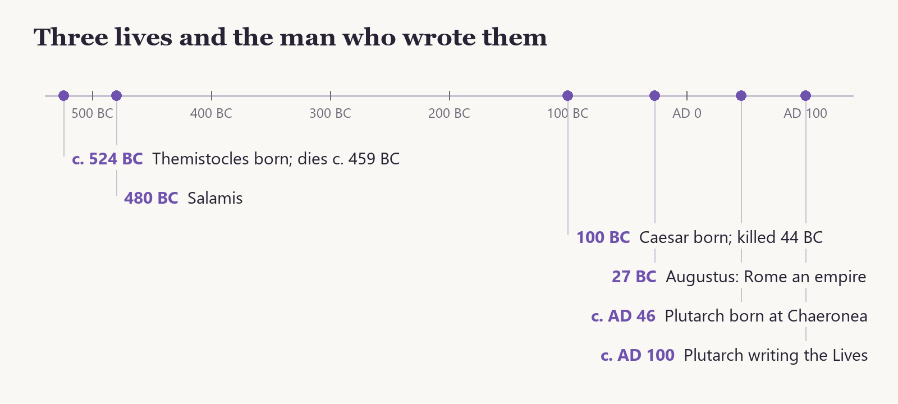
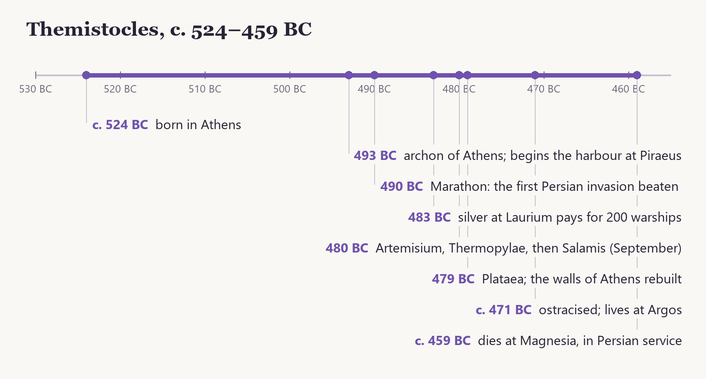

**When:** Themistocles lived from about **524 to 459 BC**, roughly 2,500 years ago. The great moment of this life is the sea battle of **Salamis, in September 480 BC**. Plutarch was writing around **AD 100**, nearly six centuries later: as far from Themistocles as we are from the fall of Constantinople and the first printed books.

## Where this sits in time

- Athens had been a democracy for barely a generation: Cleisthenes' reforms came in 508 BC, when Themistocles was a boy.
- Rome, the city of his partner in this book, Camillus, was a small new republic (traditionally founded in 509 BC) fighting its neighbours. Camillus lived a century later.
- In China, Confucius died in 479 BC, the year after Salamis. In India, the Buddha was teaching, or soon would be.
- The Parthenon didn't exist yet. It was begun in 447 BC, a decade after Themistocles died, on the hill the Persians burned in 480.
- Persia was the largest empire the world had yet seen, reaching from Egypt and Turkey to the borders of India. Herodotus, Plutarch's main source for the war, was born around 484 BC and wrote within living memory of it.

## A timeline of the life

- **c. 524 BC**: born in Athens, son of Neocles, of the district of Phrearrhi. His mother wasn't Athenian, as Plutarch says.
- **493 BC**: chief magistrate (archon) of Athens; begins making Piraeus a harbour.
- **490 BC**: the Athenians beat the first Persian invasion at Marathon, under Miltiades. Plutarch has the young Themistocles kept awake by Miltiades' trophy.
- **483 BC**: a rich new seam of silver is found at the mines of Laurium. Themistocles persuades Athens to spend it on a fleet of some 200 warships, for the war with Aegina, he says; he has Persia in mind.
- **482 BC**: his rival Aristides is ostracised, voted into ten years' exile.
- **480 BC**: Xerxes invades. The fleets fight off Artemisium while Leonidas falls at Thermopylae (August); Athens is abandoned to the Persians, and the Greek fleet wins at Salamis (September).
- **479 BC**: the Persian army is beaten at Plataea. Themistocles stalls the Spartans while Athens rebuilds its walls.
- **c. 471 BC**: Themistocles is ostracised in his turn, and lives at Argos.
- **c. 466 to 464 BC**: accused of plotting with Persia alongside the Spartan Pausanias, he flees through Corcyra, the Molossians and Pydna to Asia, and goes to the Persian king: Artaxerxes I, who came to the throne in 465 BC, as Thucydides says, rather than Xerxes, as some of Plutarch's other sources had it.
- **c. 459 BC**: dies at Magnesia on the Maeander, in what is now western Turkey, as a governor for the king. Plutarch gives his age as sixty-five.

## What Plutarch is doing

Plutarch is less interested in the war than in the man who won it. His Themistocles is brilliant, quick and far-sighted, but hungry for honour and not over-careful about money or truth. Watch how often he gets his way by a trick: the "wooden walls" oracle read as a call to the ships, the secret message to Xerxes before Salamis, the stalling of the Spartans over the walls. Aristides, the man of strict justice, is set beside him throughout, and the reader is meant to weigh the two.

The ending matters to Plutarch. The saviour of Greece dies in the service of the enemy he beat, and Plutarch prefers the story that he chose to die rather than lead a Persian army against Greeks. He closes with a Themistocles of his own day, a descendant, who had studied with him under the philosopher Ammonius: these lives weren't remote history to him, but the past of families he knew.

## What historians now think

- **Salamis** is still counted among the turning points of history. Had Greece fallen into the Persian empire, the Athens of Pericles, of the tragedians and the philosophers, might never have happened.
- **The fleet changed Athens.** The ships were rowed by the city's poorer citizens, and their importance gave them a greater voice: many historians see Themistocles' navy as the engine of the full Athenian democracy, and of the Athenian empire that followed.
- **The Troezen Decree**, an inscription found in 1959, claims to record Themistocles' motion to send the women and children to Troezen and man the ships. It was carved long afterwards, and scholars argue over how faithful it is, but it agrees closely with what Plutarch tells.
- **His death by drinking bull's blood**, which Plutarch passes on, is a legend. Thucydides, writing much nearer the time, says he died of an illness, though some said he poisoned himself.
- Plutarch uses many writers now lost (Stesimbrotus, Phanias, Theopompus and others) and often says where they disagree. Where he sets them side by side, the facts were uncertain even to him.

The translation uses the Latin names of the gods: Diana is Artemis, Minerva is Athena, Jupiter is Zeus.
