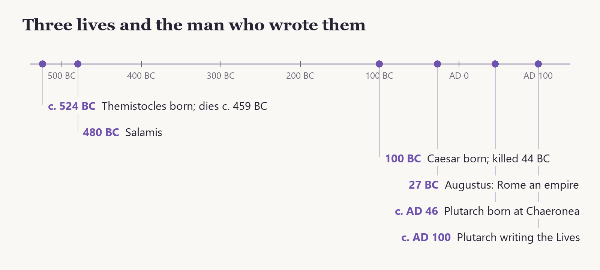
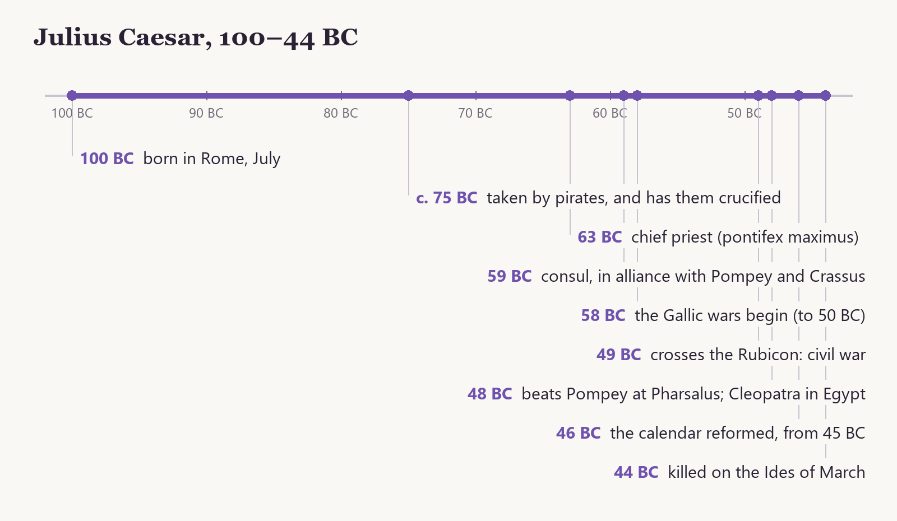

**When:** Gaius Julius Caesar lived from **July 100 BC to 15 March 44 BC**, the Ides of March: about 2,070 years ago. The life follows him from about 82 BC, when he was eighteen, to his murder at fifty-five. Plutarch was writing around **AD 100 to 120**, a century and a half after Caesar's death: as far from him as we are from the 1870s.

## Where this sits in time

- Caesar's calendar is still on your wall. Near the end of this life Plutarch tells how he reformed the Roman year, which had drifted months out of step with the seasons. The Julian calendar began on 1 January 45 BC and, with a small correction made in 1582, it's the one we use. July is named after him.
- Cleopatra, who appears here as a young queen carried in to Caesar rolled up in bedding, lived closer in time to the Moon landing than to the building of the Great Pyramid.
- Alexander the Great, Caesar's partner in this book, had died over two centuries before Caesar was born. Plutarch tells how Caesar, reading about Alexander, wept that he had done nothing memorable at an age when Alexander had conquered the world.
- Themistocles and Salamis were already four centuries in the past: as far from Caesar as Shakespeare is from us.
- Caesar's heir Octavian became the first emperor, Augustus, in 27 BC, and Jesus was born in Augustus's reign, a generation after Caesar's death. "Caesar" became the emperors' title, and lives on in *Kaiser* and *Tsar*.

## A timeline of the life

- **100 BC**: born in Rome, of an old but not wealthy noble family. His aunt Julia is married to Marius.
- **82 to 81 BC**: Sulla ("Sylla" here), Marius's enemy, rules Rome as dictator and orders Caesar to divorce Cornelia, Cinna's daughter. He refuses, and goes into hiding.
- **c. 75 BC**: captured by pirates near Pharmacusa. Once ransomed, he comes back and crucifies them, as he had joked he would.
- **63 BC**: elected chief priest (pontifex maximus). In the Catiline conspiracy he argues against putting the plotters to death.
- **62 BC**: the Bona Dea scandal. He divorces Pompeia, since Caesar's wife must be above suspicion.
- **60 to 59 BC**: allies with Pompey and Crassus (the "First Triumvirate"), and is consul in 59. Pompey marries Caesar's daughter Julia.
- **58 to 50 BC**: conquers Gaul, roughly modern France and Belgium; crosses the Rhine, and twice into Britain, in 55 and 54 BC.
- **54 to 53 BC**: Julia dies, and Crassus is killed fighting the Parthians, loosening what held Caesar and Pompey together.
- **52 BC**: the great Gallic revolt under Vercingetorix ("Vergentorix" here) ends at the siege of Alesia.
- **January 49 BC**: crosses the Rubicon, the river at the edge of his province, with his army: civil war.
- **9 August 48 BC**: beats Pompey at Pharsalus ("Pharsalia"). Pompey flees to Egypt and is murdered there.
- **48 to 47 BC**: besieged in Alexandria; makes Cleopatra queen of Egypt. Beats Pharnaces at Zela in 47: "I came, I saw, I conquered".
- **46 and 45 BC**: wins at Thapsus in Africa, after which Cato kills himself at Utica, and at Munda in Spain.
- **45 to 44 BC**: reforms the calendar; made dictator for life early in 44.
- **15 February 44 BC**: at the Lupercalia, Antony offers him a crown, which he refuses to the crowd's cheers.
- **15 March 44 BC**: stabbed to death at a meeting of the senate in Pompey's theatre, at the foot of Pompey's statue.
- **42 BC**: Brutus and Cassius are defeated at Philippi.

## What Plutarch is doing

The start of this life is lost: it opens abruptly with Sulla, without the family and childhood Plutarch usually begins with. It is paired with Alexander, and the opening of Alexander holds Plutarch's best-known words on his method: he writes lives, not histories, and a small act or a joke often shows character better than a battle with thousands dead.

His theme is ambition. From the pirates to the crown at the Lupercalia, Plutarch's Caesar wants first place and will spend anything to get it; the people's love for him and his famous mercy to beaten enemies are real, but they are also tools. Plutarch, a Greek living comfortably under the emperors Caesar's victory made possible, isn't hostile: he grants that Rome by then needed one ruler. But he ends on a religious note. The "great genius" that guided Caesar through life pursues his killers to their deaths, and the omens and dreams before the Ides are there to show that fortune had turned.

## What historians now think

- **Gaul**: Plutarch's figures, a million killed and a million enslaved, come from Caesar's side and are surely inflated, but historians agree the conquest was devastating. Caesar's own account, *The Gallic War*, survives, and is written to make him look good.
- **The fall of the Republic** is now usually seen as a long process, a century of violent rivalry among great men from the Gracchi through Marius and Sulla to Pompey and Caesar, rather than one man's doing.
- **Dates** before 45 BC are in the old, drifted Roman calendar: Pharsalus, "9 August" by the calendar, was fought in early summer by the seasons.
- **Shakespeare's** *Julius Caesar* (1599) took its story, often scene by scene, from Thomas North's English translation of this life and those of Brutus and Antony: the soothsayer, Calpurnia's dream and the crown at the Lupercalia are all here. "Et tu, Brute?" is Shakespeare's, not Plutarch's; here Caesar simply pulls his robe over his head when he sees Brutus among his attackers.

The translation's spellings can hide familiar names: Sylla is Sulla, Caius is Gaius, Vergentorix is Vercingetorix, and Pharsalia is Pharsalus.
